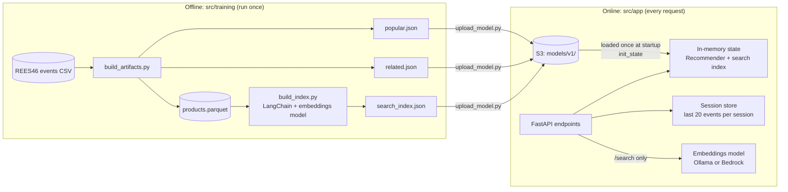
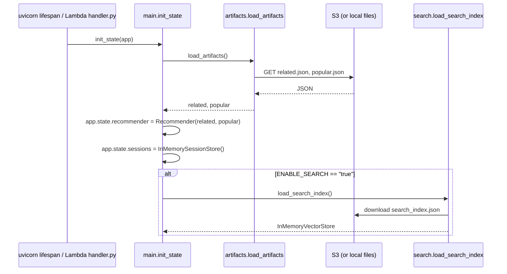
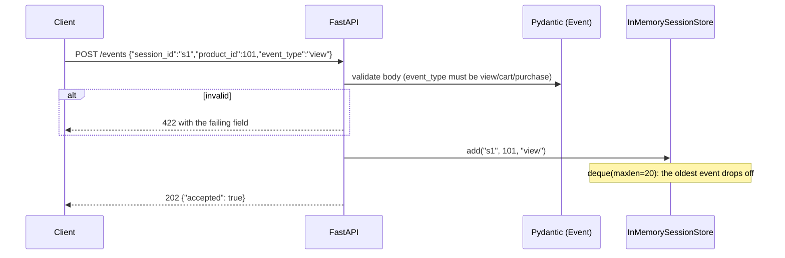
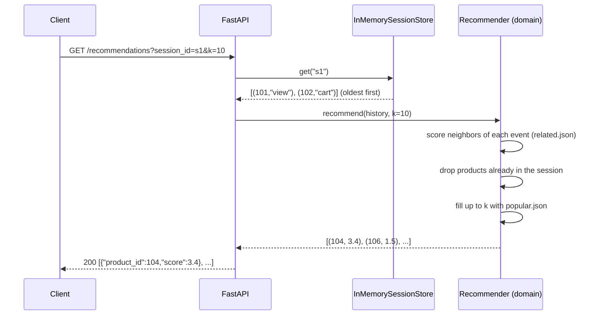
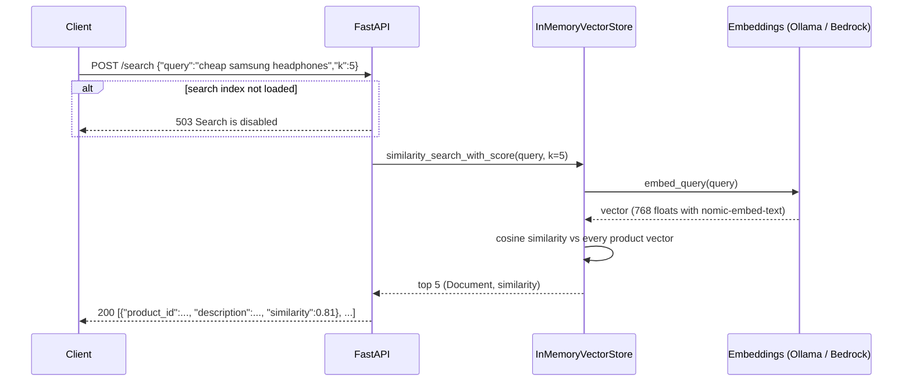
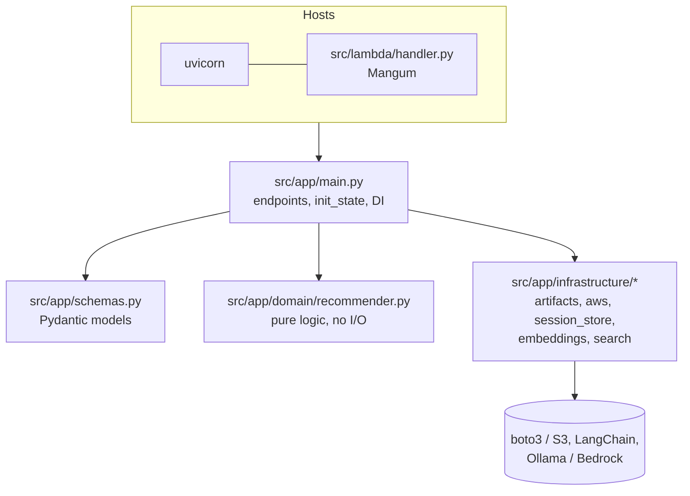
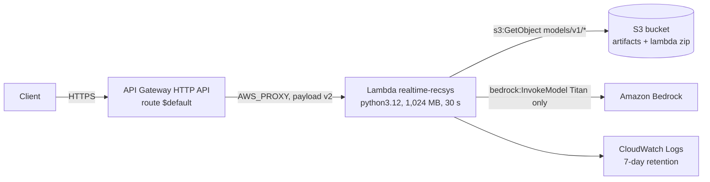

# Architecture

How RealTime RecSys works, from the big picture down to the scoring formula. For a file-by-file tour of the code, see [CODE_WALKTHROUGH.md](CODE_WALKTHROUGH.md).

## In one minute

- **Offline** (minutes, run once): Python scripts read historical e-commerce events and pre-compute three **artifacts**: popular products, "products seen together", and a semantic search index. The artifacts are uploaded to S3.
- **Online** (milliseconds, every request): a FastAPI app loads the artifacts **once at startup**. For each user event it updates the session. For each recommendation request it combines the neighbors of the session's recent products, weighted by event type and recency. That is dictionary lookups and arithmetic, with no model inference.
- **Search** is the only place that calls a model: the query is turned into an embedding and compared against pre-computed product embeddings.
- The **same code** runs locally with uvicorn and on AWS Lambda (through Mangum). Locally, AWS is emulated with Docker (moto for S3, the Lambda Runtime Interface Emulator, Ollama instead of Bedrock).

## 1. Offline vs online



The split keeps the expensive work offline. Online, a recommendation costs ~3 ms inside Lambda (p99 4.2 ms measured on AWS).

## 2. Startup (and Lambda cold start)

`init_state(app)` in `src/app/main.py` builds everything the endpoints need and stores it in `app.state`, which works like singletons in a DI container.



Who calls `init_state` depends on the host:

| Host | Trigger | Why |
|---|---|---|
| uvicorn / TestClient | FastAPI `lifespan`, before the first request | Standard ASGI startup hook (like `IHostedService.StartAsync`) |
| AWS Lambda | Module level in `src/lambda/handler.py` | Runs once per cold start and is reused while warm. Mangum would run the lifespan on **every** invocation |

On AWS this initialization took **3.36 s on average** (Python imports + downloading artifacts). It happened 248 times in 1.32M requests.

## 3. Request flows

### `POST /events`: record an interaction



### `GET /recommendations`: rank products for the session



### `POST /search`: natural-language search



## 4. The recommendation algorithm

### Offline: what the artifacts contain
`src/training/build_artifacts.py` reads the first 200,000 events of the REES46 dataset:

- **`popular.json`**: the 100 products with the highest weighted interaction count (`view` = 1, `cart` = 3, `purchase` = 5).
- **`related.json`**: for every product, the up-to-20 products that appeared **in the same sessions** most often (item-to-item co-occurrence, "people who viewed X also viewed Y"). Each session is de-duplicated in order and capped at 30 products, to avoid quadratic blow-ups from bot-like sessions.

```json
// related.json (product id as string -> neighbors, most frequent first)
{"1004856": [1004833, 1004767, 1004858, ...], ...}
// popular.json
[1004856, 1004767, 1005115, ...]
```

### Online: scoring a session
For a session history (oldest → newest), every candidate product accumulates:

```
score(candidate) += EVENT_WEIGHTS[event_type] × RECENCY_DECAY^age / (rank + 1)
```

| Term | Meaning | Value |
|---|---|---|
| `EVENT_WEIGHTS` | Strength of intent | view 1, cart 3, purchase 5 |
| `RECENCY_DECAY^age` | Older events matter less (`age` 0 = newest) | 0.8 |
| `rank + 1` | Position of the candidate in that product's neighbor list | 1st = full weight, 2nd = half… |

Then: products already in the session are excluded (this is a *discovery* list), the top `k` are returned, and if there are fewer than `k`, the list is **filled with popular products** (score 0.0). Popular products are also the whole answer for an empty session (cold start).

**Worked example** (verified against the code). Artifacts: `related = {"101": [103, 104, 105], "102": [104, 106]}`, `popular = [107, 101, 108]`. Session: `view 101`, then `cart 102`.

| Event (newest first) | Weight | Candidates (rank) | Contribution |
|---|---|---|---|
| `cart 102`, age 0 | 3 × 0.8⁰ = **3.0** | 104 (1st), 106 (2nd) | 104: 3.0 · 106: 1.5 |
| `view 101`, age 1 | 1 × 0.8¹ = **0.8** | 103 (1st), 104 (2nd), 105 (3rd) | 103: 0.8 · 104: 0.4 · 105: 0.267 |

Result for `k=6`: **104 (3.4)**, 106 (1.5), 103 (0.8), 105 (0.267), then the popular fill 107 (0.0), 108 (0.0). 101 is skipped because the user already saw it. Product 104 wins because it is a neighbor of *both* events, and of the cart event in particular.

### Search
`src/training/build_index.py` turns each product into a short text (`"electronics audio headphone samsung price 20.50 USD"`), embeds it and stores the vectors in a LangChain `InMemoryVectorStore` saved as JSON:

```json
{"<uuid>": {"id": "<uuid>", "vector": [0.0123, -0.4410, ...], "text": "electronics audio headphone ...", "metadata": {"product_id": 1004856}}}
```

At query time only the query is embedded; ranking is cosine similarity against the stored vectors. The index must be queried with **the same embeddings model** that built it. Why search uses an embeddings model and recommendations use no model at all is explained in [ADR 0002](adr/0002-llm-out-of-hot-path.md).

## 5. Layers and dependencies



- **`domain`** depends on nothing, so it is tested with plain unit tests (`tests/test_recommender.py`).
- **`infrastructure`** hides every external system behind small functions or classes. Swapping moto ↔ S3 or Ollama ↔ Bedrock is configuration, not code.
- **`main.py`** is the composition root: it creates the objects (`init_state`) and injects them into endpoints with `Depends`.
- Coming from .NET: this is Clean Architecture with `main.py` acting as `Program.cs`.

## 6. Runtime modes

| | Local, files | Local, emulated AWS | Local Lambda | AWS |
|---|---|---|---|---|
| How to run | `make run` | `source src/scripts/local-env.sh` + `make up-ai` + `make run` | `make lambda-up` + `invoke_lambda.py` | `make deploy` |
| HTTP entry | uvicorn :8000 | uvicorn :8000 | Lambda RIE :9000 (raw events) | API Gateway HTTP API |
| Startup | `lifespan` | `lifespan` | `handler.py` module level | `handler.py` module level |
| Artifacts from | `./artifacts` | moto S3 :5000 | moto S3 (`s3:5000` inside Docker) | Amazon S3 |
| Embeddings | Ollama :11434 | Ollama :11434 | Ollama (`ollama:11434`) | Amazon Bedrock (Titan) |
| Config comes from | your shell | `local-env.sh` | `docker-compose.yml` → `lambda.environment` | Terraform → `aws_lambda_function.environment` |
| Session state | process memory | process memory | memory of the one container | memory of **each** Lambda instance |

The local Lambda does **not** read your shell's variables. Change its environment in `docker-compose.yml` and recreate it (`make lambda-up`).

## 7. Configuration reference

All configuration is via environment variables (12-factor).

| Variable | Default | Used by | Meaning |
|---|---|---|---|
| `ARTIFACTS_SOURCE` | `local` | `artifacts.py`, `search.py` | `local` = read files; `s3` = read from S3 |
| `ARTIFACTS_DIR` | `artifacts` | `artifacts.py`, `search.py` | Folder for `local` mode |
| `ARTIFACTS_BUCKET` | — (required for `s3`) | `artifacts.py`, `search.py`, `upload_model.py` | Bucket with the artifacts |
| `ARTIFACTS_PREFIX` | `models/v1` | same | Key prefix. Bump it to version a new model |
| `S3_ENDPOINT_URL` | empty (= real AWS) | `aws.py`, `upload_model.py` | Set to `http://localhost:5000` to use moto |
| `ENABLE_SEARCH` | unset (= off) | `main.py` | `"true"` loads the search index; otherwise `/search` returns 503 |
| `EMBEDDINGS_PROVIDER` | `ollama` | `embeddings.py`, `build_index.py` | `ollama` or `bedrock` |
| `OLLAMA_URL` | `http://localhost:11434` | `embeddings.py` | Ollama server |
| `AWS_DEFAULT_REGION`, `AWS_ACCESS_KEY_ID`, `AWS_SECRET_ACCESS_KEY` | AWS SDK defaults | boto3 | Fake `test` values locally; the IAM role on Lambda |

S3 layout:
```
s3://<bucket>/
├── models/v1/popular.json
├── models/v1/related.json
├── models/v1/search_index.json
└── lambda/realtime-recsys.zip      # deployment package (uploaded by Terraform)
```

## 8. AWS deployment

Terraform (`src/infra/terraform`) creates 13 resources:



- **Least privilege:** the Lambda role can read only `models/v1/*` and invoke only the Titan embeddings model.
- **Package from S3:** the zip is ~45 MB (124 MB unzipped), close to the 50 MB limit for direct upload, so Lambda reads it from the bucket ([ADR 0004](adr/0004-lambda-zip-from-s3.md)).
- **One route (`$default`):** API Gateway forwards everything and FastAPI does the routing.

## 9. Known limitations

| Limitation | Impact | Where it is addressed |
|---|---|---|
| Session state in process memory | Sessions are lost or split across Lambda instances | [ADR 0001](adr/0001-session-state.md) → DynamoDB |
| Raw co-occurrence counts | Popular products appear as "related" to everything (popularity bias) | Next step: normalize (cosine / lift) |
| Sample = first 200K events | Not a random sample (first hours of October) | Next step: temporal split + offline evaluation |
| ~3.4 s cold start | Cold starts amplify scale-out (peak 275 instances) | README → Findings §6: smaller package, SnapStart, provisioned concurrency |
| Poor product text for search | Category + brand + price only; "cheap" is not understood as a price range | [ADR 0002](adr/0002-llm-out-of-hot-path.md): self-query filters, richer descriptions |
