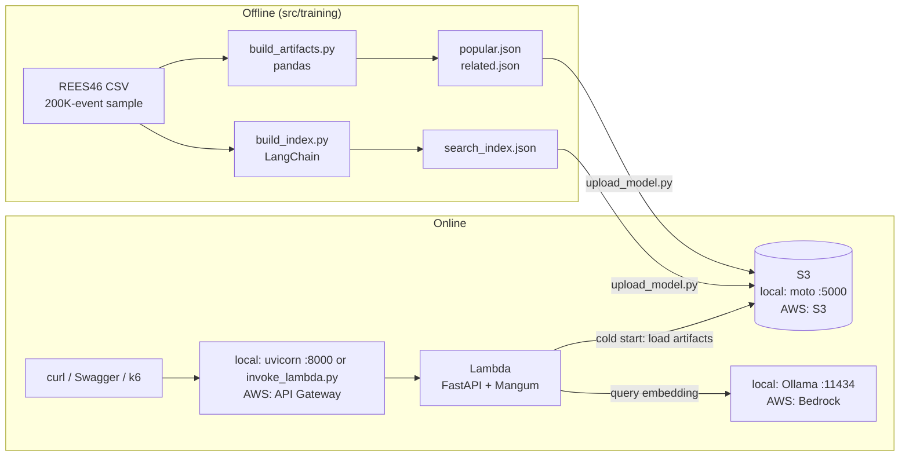

# Implementation Plan — RealTime RecSys

Build the **working foundation** of a real-time e-commerce recommendation system in **8 short sessions of ~1 hour each**, learning the stack along the way: Python, FastAPI, AWS Lambda, S3, LangChain and Terraform.

**Days 1–7 run entirely on your machine for $0** (no AWS account needed). S3, Lambda and the embeddings model are emulated with Docker. **Day 8 (optional)** deploys once to real AWS with Terraform, so the README can show a live URL and real measurements.

By the end, the system:
1. Receives user events (`view`, `cart`, `purchase`).
2. Returns recommendations that **change with what the user does in the current session**.
3. Loads its "model" from **S3**.
4. Runs as an **AWS Lambda** function (locally via the Runtime Interface Emulator).
5. Offers natural-language product search with **LangChain**.

> **Shell:** commands are written for **bash** (Linux, macOS, WSL, Git Bash or the Dev Container). On Windows PowerShell, see [Windows (PowerShell) equivalents](#windows-powershell-equivalents). Most steps also have a `make` shortcut ([Makefile shortcuts](#makefile-shortcuts)).

> **Golden rule:** every day has a "Done when" checklist. When the hour is up, finish that checklist and stop. Do not start the next day early.

### Out of scope for this first pass (see "Next steps")
DynamoDB, Item2Vec/FAISS candidates, NDCG evaluation, frontend. Foundation first, sophistication later.

---

## Phases and days

| Phase (README) | Days | Status |
|---|---|---|
| 1. Design & data | Day 0 (setup), Day 1 (FastAPI skeleton), Day 2 (data + baseline artifacts) | ✅ |
| 2. Backend: FastAPI + AWS Lambda | Day 3 (real-time API), Day 4 (S3), Day 5 (Lambda) | ✅ |
| 3. LangChain integration | Day 6 (semantic search) | ✅ |
| 4. Deploy, latency & load testing | Day 7 (CI + k6 locally), Day 8 (Terraform + AWS + k6) | ✅ Day 7 (CI green, k6 local) and Day 8 (deployed and load-tested on AWS) |

What each day actually produced is recorded in [Findings log](#findings-log).

---

## Stack: local vs real AWS

| Piece | Local development ($0) | Real AWS (Day 8) | .NET / Azure equivalent |
|---|---|---|---|
| Language | **Python 3.12** | Lambda runtime `python3.12` | C# |
| Packages / environment | **uv** + `pyproject.toml` + `uv.lock` | Same lock, `build_lambda.py` | `dotnet` CLI + `.csproj` + NuGet |
| API | **FastAPI** + **Pydantic** | Same code | Minimal APIs + records / DataAnnotations |
| Dependency injection | FastAPI `Depends()` | Same | ASP.NET Core DI |
| Offline data | **pandas** + Parquet | Same | LINQ over collections |
| Tests | **pytest** + **moto** (in-memory AWS mocks) | — | xUnit + mocks |
| Compute | Lambda base image + Runtime Interface Emulator (`docker compose`) | **AWS Lambda** + **Mangum** | Azure Functions Core Tools → Azure Functions |
| HTTP entry point | `invoke_lambda.py` (builds the API Gateway event) | **API Gateway (HTTP API)** | APIM / Function URL |
| Storage | **moto server** (fake S3 on `:5000`) | **Amazon S3** | Azurite → Blob Storage |
| Embeddings | **Ollama** + `nomic-embed-text` | **Amazon Bedrock** Titan Embeddings V2 | Ollama → Azure OpenAI |
| Vector store | LangChain `InMemoryVectorStore` (JSON file) | Same | Semantic Kernel memory |
| Infrastructure as code | — | **Terraform** | Bicep / ARM |
| Load testing | **k6** (Docker) | k6 against API Gateway | Azure Load Testing |
| CI | **GitHub Actions** | — | Azure DevOps Pipelines |

> **Why moto and not LocalStack:** since March 2026 LocalStack requires an account and an auth token (with a free non-commercial plan). This project only needs S3 emulated. moto does that for free with no sign-up, and it is the same library used in the tests.

---

## Architecture



### Endpoints
| Method | Route | Purpose | Day |
|---|---|---|---|
| `GET` | `/health` | Health check | 1 |
| `GET` | `/recommendations?session_id=...&k=10` | Session-based recommendations (popular items when the session is empty) | 1 → 3 |
| `POST` | `/events` | Record an event in the session | 3 |
| `POST` | `/search` | Natural-language product search (LangChain) | 6 |

### Final repository layout
```
realtime-recsys/
├── .devcontainer/
│   ├── devcontainer.json          # optional Dev Container
│   └── docker-compose.yml         # adds the "dev" container
├── .github/workflows/ci.yml       # Day 7
├── docker-compose.yml             # s3 (moto), ollama, lambda (RIE), k6
├── loadtest/k6.js
├── src/
│   ├── app/                       # importable package `app`
│   │   ├── main.py                # FastAPI app, endpoints, init_state, lifespan
│   │   ├── schemas.py             # Pydantic models
│   │   ├── domain/
│   │   │   └── recommender.py     # pure ranking logic (no I/O)      Day 3
│   │   └── infrastructure/
│   │       ├── session_store.py   # in-memory session                Day 3
│   │       ├── artifacts.py       # load artifacts (local or S3)     Day 3-4
│   │       ├── aws.py             # S3 client (local or real)        Day 4
│   │       ├── embeddings.py      # Ollama or Bedrock                Day 6
│   │       └── search.py          # semantic index                   Day 6
│   ├── lambda/
│   │   └── handler.py             # Lambda entry point (Mangum)
│   ├── training/                  # importable package `training`
│   │   ├── build_artifacts.py     # popularity + co-occurrence       Day 2
│   │   └── build_index.py         # LangChain search index           Day 6
│   ├── scripts/
│   │   ├── build_lambda.py        # builds build/lambda + build/lambda.zip
│   │   ├── invoke_lambda.py       # calls the local Lambda with an API Gateway event
│   │   ├── upload_model.py        # uploads artifacts/ to S3 (local or AWS)
│   │   ├── local-env.sh           # env vars for local mode (bash: source it)
│   │   └── local-env.ps1          # same for Windows PowerShell
│   └── infra/terraform/           # API Gateway, Lambda, S3, IAM, logs   Day 8
├── tests/
├── data/          (git-ignored)   # raw CSV and Parquet
├── artifacts/     (git-ignored)   # training output
├── build/         (git-ignored)   # Lambda package
├── docs/
│   ├── ARCHITECTURE.md            # how it works (flows, algorithm, configuration)
│   ├── CODE_WALKTHROUGH.md        # file-by-file guide
│   ├── PLAN.md
│   ├── openapi.json
│   └── adr/
├── Makefile                       # shortcuts for every step
├── pyproject.toml
└── uv.lock
```

`src/app` and `src/training` are installed in editable mode by `uv sync` (see `[tool.hatch...]` in `pyproject.toml`). So `import app` works from tests, scripts and uvicorn without touching `PYTHONPATH`.

`src/lambda` is **not** a package (`lambda` is a Python keyword). `build_lambda.py` copies `handler.py` to the root of the Lambda package.

---

## Day 0 — Setup (once, ~20 min, no AWS account)

- [ ] Install:
  - [uv](https://docs.astral.sh/uv/getting-started/installation/): `curl -LsSf https://astral.sh/uv/install.sh | sh` (Windows: `powershell -ExecutionPolicy ByPass -c "irm https://astral.sh/uv/install.ps1 | iex"`)
  - Docker (Docker Desktop on Windows/macOS)
  - `make` (preinstalled on most Linux/macOS; on Windows use WSL, Git Bash or the Dev Container)
  - VS Code. Open the repo and install the recommended extensions (`@recommended` in the Extensions view).
- [ ] Windows PowerShell only: allow local scripts (once) with `Set-ExecutionPolicy -Scope CurrentUser RemoteSigned`
- [ ] Download the Kaggle dataset **"eCommerce behavior data from multi category store"** (author: mkechinov). You only need **`2019-Oct.csv`** (~5 GB).
- [ ] Check: `uv --version`, `docker --version`, `docker compose version`, `make --version`.

Not needed until Day 8: AWS account, AWS CLI, Terraform.

> **Alternative:** "Dev Containers: Reopen in Container" gives you Python 3.12 and uv inside Linux, with the local S3 already wired (start Ollama from the host with `docker compose --profile ai up -d`). You can skip `source src/scripts/local-env.sh` there, because the variables are already set.

---

## Day 1 — Modern Python + FastAPI ✅

**You learn:** uv, project layout, Pydantic, FastAPI basics, automatic Swagger.

Already in the repo:
- `pyproject.toml` / `uv.lock`: dependencies (`fastapi`, `pydantic`, `mangum`, `boto3`) and dev tools (`pytest`, `httpx`, `ruff`, `uvicorn`).
- `src/app/schemas.py`: `Event` and `Recommendation`.
- `src/app/main.py`: `GET /health` and `GET /recommendations` with hard-coded data.
- `tests/test_health.py`: health check and 422 validation.
- `src/lambda/handler.py` + `tests/test_lambda_handler.py`: the same app called as a Lambda function.

```bash
uv sync
uv run pytest -v
uv run uvicorn app.main:app --reload     # http://127.0.0.1:8000/docs
```

### Done when
- [x] Swagger (`/docs`) shows both endpoints and they respond.
- [x] `http://127.0.0.1:8000/recommendations?session_id=s1&k=abc` (from the browser, curl or REST Client) returns **422**. Swagger blocks the invalid value before sending it, so test it outside Swagger. This is Pydantic validation.

---

## Day 2 — Data and the first recommender (offline)

**You learn:** pandas, Parquet, and co-occurrence recommendations ("people who viewed X also viewed Y").

### Steps
1. Dev-only dependencies (they never go to Lambda): `uv add --dev pandas pyarrow`
2. Copy `2019-Oct.csv` to `data/raw/`.
3. Explore for 5 minutes in a REPL (`uv run python`), or in a notebook with Data Wrangler:
   ```python
   import pandas as pd
   df = pd.read_csv("data/raw/2019-Oct.csv", nrows=1000)
   df.head(); df.dtypes; df["event_type"].value_counts()
   ```
   Columns: `event_time, event_type, product_id, category_id, category_code, brand, price, user_id, user_session`.
4. `src/training/build_artifacts.py`:
   ```python
   """Build the recommender artifacts from a sample of the REES46 dataset."""

   import itertools
   import json
   from collections import Counter, defaultdict
   from pathlib import Path

   import pandas as pd

   RAW = Path("data/raw/2019-Oct.csv")
   PROCESSED = Path("data/processed")
   ARTIFACTS = Path("artifacts")
   SAMPLE_ROWS = 200_000
   EVENT_WEIGHTS = {"view": 1, "cart": 3, "purchase": 5}


   def main() -> None:
       PROCESSED.mkdir(parents=True, exist_ok=True)
       ARTIFACTS.mkdir(exist_ok=True)

       # nrows avoids loading the full ~5 GB file
       df = pd.read_csv(RAW, nrows=SAMPLE_ROWS).dropna(subset=["user_session"])
       df.to_parquet(PROCESSED / "events.parquet", index=False)
       (
           df[["product_id", "category_code", "brand", "price"]]
           .drop_duplicates("product_id")
           .to_parquet(PROCESSED / "products.parquet", index=False)
       )

       # 1) Popular items: weighted sum by event type
       df["weight"] = df["event_type"].map(EVENT_WEIGHTS)
       popular = df.groupby("product_id")["weight"].sum().nlargest(100).index
       (ARTIFACTS / "popular.json").write_text(json.dumps([int(p) for p in popular]))

       # 2) Co-occurrence: products seen in the same session
       cooc: dict[int, Counter] = defaultdict(Counter)
       sessions = df.groupby("user_session")["product_id"].apply(lambda s: list(dict.fromkeys(s)))
       for items in sessions:
           for a, b in itertools.permutations(items[:30], 2):
               cooc[a][b] += 1
       related = {str(a): [int(b) for b, _ in c.most_common(20)] for a, c in cooc.items()}
       (ARTIFACTS / "related.json").write_text(json.dumps(related))

       print(f"events={len(df):,} products_with_related={len(related):,}")


   if __name__ == "__main__":
       main()
   ```
5. Run it from the repo root: `uv run python -m training.build_artifacts`
6. Inspect the result:
   ```bash
   uv run python -c "import json; r=json.load(open('artifacts/related.json')); k=next(iter(r)); print(k, r[k][:10])"
   ```

### Done when
- [ ] `artifacts/popular.json` and `artifacts/related.json` exist.
- [ ] Given a `product_id`, you can list its 10 related products.
- [ ] You can explain what `groupby` does and why `dict.fromkeys` removes duplicates while keeping order.

**Suggested commit:** `feat(training): popularity and co-occurrence artifacts`

---

## Day 3 — Real time: events + session + DI + tests

**You learn:** separating domain from infrastructure, initialization that works for both uvicorn and Lambda, `Depends()`, pytest fixtures.

### Steps
1. `src/app/domain/recommender.py` (pure logic, no I/O):
   ```python
   from collections import Counter

   EVENT_WEIGHTS = {"view": 1.0, "cart": 3.0, "purchase": 5.0}
   RECENCY_DECAY = 0.8  # the most recent event weighs the most


   class Recommender:
       def __init__(self, related: dict[str, list[int]], popular: list[int]):
           self._related = related
           self._popular = popular

       def recommend(self, history: list[tuple[int, str]], k: int = 10) -> list[tuple[int, float]]:
           seen = {pid for pid, _ in history}
           scores: Counter[int] = Counter()

           for age, (pid, event_type) in enumerate(reversed(history)):
               weight = EVENT_WEIGHTS[event_type] * (RECENCY_DECAY**age)
               for rank, candidate in enumerate(self._related.get(str(pid), [])):
                   if candidate not in seen:
                       scores[candidate] += weight / (rank + 1)

           result = [(pid, round(score, 4)) for pid, score in scores.most_common(k)]

           # Fill with popular items (also the cold-start answer when there is no history)
           for pid in self._popular:
               if len(result) >= k:
                   break
               if pid not in seen and pid not in scores:
                   result.append((pid, 0.0))
           return result
   ```
2. `src/app/infrastructure/session_store.py`:
   ```python
   from collections import defaultdict, deque


   class InMemorySessionStore:
       """Keeps the last N interactions per session. WARNING: lives in the process memory."""

       def __init__(self, max_events: int = 20):
           self._sessions: dict[str, deque] = defaultdict(lambda: deque(maxlen=max_events))

       def add(self, session_id: str, product_id: int, event_type: str) -> None:
           self._sessions[session_id].append((product_id, event_type))

       def get(self, session_id: str) -> list[tuple[int, str]]:
           return list(self._sessions.get(session_id, []))
   ```
3. `src/app/infrastructure/artifacts.py` (local files for now; S3 arrives on Day 4):
   ```python
   import json
   import os
   from pathlib import Path


   def load_artifacts() -> tuple[dict[str, list[int]], list[int]]:
       base = Path(os.getenv("ARTIFACTS_DIR", "artifacts"))

       def read(name: str):
           return json.loads((base / name).read_text())

       return read("related.json"), read("popular.json")
   ```
4. Replace `src/app/main.py`:
   ```python
   from contextlib import asynccontextmanager
   from typing import Annotated

   from fastapi import Depends, FastAPI, Request

   from app.domain.recommender import Recommender
   from app.infrastructure.artifacts import load_artifacts
   from app.infrastructure.session_store import InMemorySessionStore
   from app.schemas import Event, Recommendation


   def init_state(app: FastAPI) -> None:
       """Load the model and create shared objects. Runs once per process (or Lambda cold start)."""
       related, popular = load_artifacts()
       app.state.recommender = Recommender(related, popular)
       app.state.sessions = InMemorySessionStore()


   @asynccontextmanager
   async def lifespan(app: FastAPI):
       init_state(app)  # uvicorn and TestClient. Lambda calls init_state from handler.py instead.
       yield


   app = FastAPI(title="RealTime RecSys", lifespan=lifespan)


   def get_recommender(request: Request) -> Recommender:
       return request.app.state.recommender


   def get_sessions(request: Request) -> InMemorySessionStore:
       return request.app.state.sessions


   RecommenderDep = Annotated[Recommender, Depends(get_recommender)]
   SessionsDep = Annotated[InMemorySessionStore, Depends(get_sessions)]


   @app.get("/health")
   def health():
       return {"status": "ok"}


   @app.post("/events", status_code=202)
   def track_event(event: Event, sessions: SessionsDep):
       sessions.add(event.session_id, event.product_id, event.event_type)
       return {"accepted": True}


   @app.get("/recommendations", response_model=list[Recommendation])
   def recommendations(session_id: str, recommender: RecommenderDep, sessions: SessionsDep, k: int = 10):
       history = sessions.get(session_id)
       return [Recommendation(product_id=p, score=s) for p, s in recommender.recommend(history, k)]
   ```
5. Update `src/lambda/handler.py` so Lambda initializes once per cold start:
   ```python
   from mangum import Mangum

   from app.main import app, init_state

   init_state(app)  # module level = once per cold start, reused while the instance is warm
   handler = Mangum(app, lifespan="off")
   ```
   > **Why not just use the lifespan?** Mangum runs the FastAPI lifespan on *every* invocation. With `lifespan="on"` the model would be reloaded and the session store recreated on each request.
6. Tests. Every test now gets a tiny model on disk. Create `tests/conftest.py`:
   ```python
   import json

   import pytest
   from fastapi.testclient import TestClient


   @pytest.fixture(autouse=True)
   def local_artifacts(tmp_path, monkeypatch):
       """Tiny model on disk + a clean, local-only environment for every test."""
       (tmp_path / "related.json").write_text(json.dumps({"1": [2, 3]}))
       (tmp_path / "popular.json").write_text(json.dumps([9, 8]))
       monkeypatch.setenv("ARTIFACTS_SOURCE", "local")
       monkeypatch.setenv("ARTIFACTS_DIR", str(tmp_path))
       monkeypatch.delenv("S3_ENDPOINT_URL", raising=False)
       monkeypatch.delenv("ENABLE_SEARCH", raising=False)
       return tmp_path


   @pytest.fixture
   def client():
       from app.main import app

       with TestClient(app) as test_client:  # "with" runs the lifespan (init_state)
           yield test_client
   ```
7. Replace `tests/test_health.py`:
   ```python
   def test_health(client):
       response = client.get("/health")
       assert response.status_code == 200
       assert response.json() == {"status": "ok"}


   def test_invalid_k_returns_422(client):
       response = client.get("/recommendations", params={"session_id": "s1", "k": "abc"})
       assert response.status_code == 422
   ```
8. `tests/test_recommender.py`:
   ```python
   from app.domain.recommender import Recommender


   def test_empty_history_returns_popular():
       rec = Recommender(related={}, popular=[9, 8, 7])
       assert [p for p, _ in rec.recommend([], k=2)] == [9, 8]


   def test_cart_weighs_more_than_view():
       rec = Recommender(related={"1": [10], "2": [20]}, popular=[])
       result = rec.recommend([(1, "cart"), (2, "view")], k=2)
       assert result[0][0] == 10


   def test_does_not_recommend_seen_items():
       rec = Recommender(related={"1": [2, 3]}, popular=[])
       result = rec.recommend([(1, "view"), (2, "view")], k=5)
       assert 2 not in [p for p, _ in result]
   ```
   > In `test_cart_weighs_more_than_view`, product 2 is the most recent event (decay 1.0, view → 1.0). Product 1 has decay 0.8 (cart → 3.0 × 0.8 = 2.4), so the cart wins. Do the math yourself to understand the scoring.
9. `tests/test_api.py`:
   ```python
   def test_recommendations_change_after_event(client):
       before = client.get("/recommendations", params={"session_id": "s1", "k": 2}).json()
       client.post("/events", json={"session_id": "s1", "product_id": 1, "event_type": "view"})
       after = client.get("/recommendations", params={"session_id": "s1", "k": 2}).json()

       assert [r["product_id"] for r in before] == [9, 8]  # empty session -> popular
       assert [r["product_id"] for r in after] == [2, 3]  # related to product 1
   ```
10. Replace `tests/test_lambda_handler.py`. The handler now loads the model at import time, so it must be loaded *after* the fixture prepares the environment:
    ```python
    """Invoke the Lambda handler in-process with an API Gateway HTTP API (v2) event."""

    import importlib.util
    import json
    from pathlib import Path

    import pytest

    SRC = Path(__file__).resolve().parents[1] / "src"


    def load_module(name: str, path: Path):
        spec = importlib.util.spec_from_file_location(name, path)
        module = importlib.util.module_from_spec(spec)
        spec.loader.exec_module(module)
        return module


    # `lambda` is a Python keyword, so these files are loaded by path instead of imported.
    invoke_lambda = load_module("invoke_lambda", SRC / "scripts" / "invoke_lambda.py")


    class FakeLambdaContext:
        function_name = "realtime-recsys-test"


    @pytest.fixture
    def handler():
        # Loaded inside a fixture so the autouse `local_artifacts` fixture runs first (cold start).
        return load_module("lambda_handler", SRC / "lambda" / "handler.py").handler


    def call(handler, method, path, body=None):
        response = handler(invoke_lambda.build_event(method, path, body), FakeLambdaContext())
        return response["statusCode"], json.loads(response["body"])


    def test_health_through_lambda_handler(handler):
        assert call(handler, "GET", "/health") == (200, {"status": "ok"})


    def test_validation_error_through_lambda_handler(handler):
        status, _ = call(handler, "GET", "/recommendations?session_id=s1&k=abc")
        assert status == 422


    def test_session_survives_between_warm_invocations(handler):
        event = json.dumps({"session_id": "s1", "product_id": 1, "event_type": "view"})
        call(handler, "POST", "/events", event)
        _, body = call(handler, "GET", "/recommendations?session_id=s1&k=2")
        assert [r["product_id"] for r in body] == [2, 3]
    ```
11. Run `uv run pytest -v` and `uv run ruff check .`
12. Try it in Swagger with a real `product_id` from your `related.json` (the app reads `artifacts/` by default). Send 2–3 events and watch the recommendations change.

### Done when
- [ ] All tests pass.
- [ ] In Swagger the recommendations **change after every event**. That is the "real time".
- [ ] You can explain why Lambda initializes in `handler.py` and not in the lifespan.

**Suggested commit:** `feat(api): session-aware recommendations with events endpoint`

---

## Day 4 — S3 (emulated with moto)

**You learn:** boto3, buckets and prefixes, configurable endpoints (local vs real), mocking AWS in tests, docker compose.

### Steps
1. Test dependency (boto3 is already a runtime dependency): `uv add --dev "moto[s3]"`
2. Start the fake S3 and switch your terminal to local mode:
   ```bash
   docker compose up -d                 # moto on http://localhost:5000
   source src/scripts/local-env.sh      # exports the variables into this shell
   ```
   Open http://localhost:5000/moto-api/ to see moto's dashboard.
3. Upload your artifacts. moto keeps everything **in memory**, so repeat this after every restart:
   ```bash
   uv run python src/scripts/upload_model.py --create-bucket
   ```
   Read `src/scripts/upload_model.py`: it is the same boto3 code you would use against AWS.
4. `src/app/infrastructure/aws.py`, the only place that decides whether S3 is local or real:
   ```python
   import os

   import boto3
   from botocore.config import Config


   def s3_client():
       # Empty or unset = real AWS. A value = local S3 (moto).
       endpoint = os.getenv("S3_ENDPOINT_URL") or None
       config = Config(s3={"addressing_style": "path"}) if endpoint else None
       return boto3.client("s3", endpoint_url=endpoint, config=config)
   ```
5. Update `src/app/infrastructure/artifacts.py` to read from **local files or S3**:
   ```python
   import json
   import os
   from pathlib import Path

   from app.infrastructure.aws import s3_client


   def load_artifacts() -> tuple[dict[str, list[int]], list[int]]:
       if os.getenv("ARTIFACTS_SOURCE", "local") == "s3":
           bucket = os.environ["ARTIFACTS_BUCKET"]
           prefix = os.getenv("ARTIFACTS_PREFIX", "models/v1")
           s3 = s3_client()

           def read(name: str):
               obj = s3.get_object(Bucket=bucket, Key=f"{prefix}/{name}")
               return json.loads(obj["Body"].read())
       else:
           base = Path(os.getenv("ARTIFACTS_DIR", "artifacts"))

           def read(name: str):
               return json.loads((base / name).read_text())

       return read("related.json"), read("popular.json")
   ```
6. `tests/test_artifacts_s3.py` (moto in memory, no server needed):
   ```python
   import json

   import boto3
   from moto import mock_aws

   from app.infrastructure.artifacts import load_artifacts


   @mock_aws
   def test_load_artifacts_from_s3(monkeypatch):
       monkeypatch.setenv("AWS_DEFAULT_REGION", "us-east-1")
       monkeypatch.setenv("ARTIFACTS_SOURCE", "s3")
       monkeypatch.setenv("ARTIFACTS_BUCKET", "test-bucket")
       monkeypatch.setenv("ARTIFACTS_PREFIX", "models/v1")

       s3 = boto3.client("s3", region_name="us-east-1")
       s3.create_bucket(Bucket="test-bucket")
       s3.put_object(Bucket="test-bucket", Key="models/v1/related.json", Body=json.dumps({"1": [2]}))
       s3.put_object(Bucket="test-bucket", Key="models/v1/popular.json", Body=json.dumps([5]))

       related, popular = load_artifacts()
       assert related == {"1": [2]}
       assert popular == [5]
   ```
7. Run the API reading from the fake S3 (same shell where you sourced `local-env.sh`):
   ```bash
   uv run uvicorn app.main:app --reload
   ```

### Done when
- [ ] `uv run pytest` passes (the S3 test does not need the moto server running).
- [ ] You rename the `artifacts/` folder and the API still works, because it reads from the local S3.

**Suggested commit:** `feat(infra): load model artifacts from S3 (moto locally)`

---

## Day 5 — AWS Lambda locally

**You learn:** the Lambda execution model (handler, cold vs warm start), packaging, the API Gateway event format, and why Lambda memory is not shared state.

### Steps
1. Read the three files that make this work:
   - `src/lambda/handler.py`: Mangum wraps FastAPI. `init_state` runs at cold start.
   - `src/scripts/build_lambda.py`: installs the runtime dependencies **for Linux / Python 3.12** and adds `app/` + `handler.py`.
   - `docker-compose.yml` → `lambda` service: the official AWS image `public.ecr.aws/lambda/python:3.12`, which includes the Runtime Interface Emulator (RIE).
2. Build the package. Repeat this after every code or dependency change:
   ```bash
   uv run python src/scripts/build_lambda.py
   ```
   Look at `build/lambda/`: this is exactly what AWS will run.
3. Start the Lambda. It reads the model from the moto S3, so do Day 4 step 3 first:
   ```bash
   docker compose --profile lambda up -d lambda
   docker compose logs -f lambda        # Ctrl+C to stop following
   ```
4. Invoke it. The RIE expects a Lambda *event*, not plain HTTP. `invoke_lambda.py` builds the same event API Gateway sends:
   ```bash
   uv run python src/scripts/invoke_lambda.py GET /health
   uv run python src/scripts/invoke_lambda.py GET "/recommendations?session_id=s1&k=5"
   uv run python src/scripts/invoke_lambda.py POST /events --body '{"session_id":"s1","product_id":1004856,"event_type":"view"}'
   uv run python src/scripts/invoke_lambda.py GET "/recommendations?session_id=s1&k=5"
   ```
   Use a `product_id` from your `related.json`. (`--body-file event.json` is also available, which is handy on PowerShell.)
5. **Experiment 1: cold vs warm.** Compare the milliseconds of the first call against the next ones. The logs show `Init Duration` on the first one (loading Python + `init_state`).
6. **Experiment 2: memory is not shared state.** Send an event, then restart the function (`docker compose restart lambda`, which works like a new Lambda instance) and ask for recommendations again: **the session is gone**. In AWS this happens whenever Lambda recycles an instance or runs several in parallel. Each instance has its own memory, so an event can land on one instance and the next request on another.
7. Write your first ADR: `docs/adr/0001-session-state.md` (in-memory vs DynamoDB, with what you observed).

### Done when
- [ ] The API answers through the local Lambda, reading the model from the local S3.
- [ ] You measured cold vs warm start.
- [ ] You saw the session disappear and can explain why production needs DynamoDB (or ElastiCache).

**Suggested commit:** `docs(adr): session state on Lambda`

---

## Day 6 — LangChain: natural-language search (local embeddings)

**You learn:** embeddings, vector stores, LangChain `Document`, swapping providers without touching the rest of the code, and why the LLM is **not** in the recommendation hot path.

### Steps
1. Start Ollama. The first time, it downloads the `nomic-embed-text` model (~270 MB):
   ```bash
   docker compose --profile ai up -d
   docker compose logs ollama-init      # wait for "success"
   ```
   > If you already run Ollama natively on your machine, port 11434 is taken. Stop the native app or remove the `ports` mapping of the `ollama` service.
2. Dependencies:
   ```bash
   uv add langchain-core langchain-ollama numpy
   ```
   > This uses LangChain's `InMemoryVectorStore` from `langchain-core`. It stores the index as JSON (no pickle) and is fast enough for a few thousand products. `langchain-community`, where the FAISS integration lived, is being retired.
3. `src/app/infrastructure/embeddings.py`, the provider factory:
   ```python
   import os

   from langchain_core.embeddings import Embeddings


   def get_embeddings() -> Embeddings:
       provider = os.getenv("EMBEDDINGS_PROVIDER", "ollama")

       if provider == "ollama":
           from langchain_ollama import OllamaEmbeddings

           return OllamaEmbeddings(
               model="nomic-embed-text",
               base_url=os.getenv("OLLAMA_URL") or "http://localhost:11434",
           )
       if provider == "bedrock":  # used on Day 8
           from langchain_aws import BedrockEmbeddings

           return BedrockEmbeddings(model_id="amazon.titan-embed-text-v2:0")

       raise ValueError(f"Unsupported EMBEDDINGS_PROVIDER: {provider}")
   ```
4. `src/training/build_index.py`:
   ```python
   """Build a semantic product index with LangChain."""

   import os

   import pandas as pd
   from langchain_core.documents import Document
   from langchain_core.vectorstores import InMemoryVectorStore

   from app.infrastructure.embeddings import get_embeddings

   MAX_PRODUCTS = 5_000


   def describe(row) -> str:
       category = row.category_code if pd.notna(row.category_code) else "unknown category"
       brand = row.brand if pd.notna(row.brand) else "unknown brand"
       return f"{category.replace('.', ' ')} {brand} price {row.price:.2f} USD"


   def main() -> None:
       products = pd.read_parquet("data/processed/products.parquet").head(MAX_PRODUCTS)
       docs = [
           Document(page_content=describe(r), metadata={"product_id": int(r.product_id)})
           for r in products.itertuples()
       ]
       index = InMemoryVectorStore.from_documents(docs, get_embeddings())
       index.dump("artifacts/search_index.json")
       print(f"indexed={len(docs):,} provider={os.getenv('EMBEDDINGS_PROVIDER', 'ollama')}")


   if __name__ == "__main__":
       main()
   ```
   Run: `uv run python -m training.build_index`. On CPU it takes a few minutes. Lower `MAX_PRODUCTS` to 500 for a quick first run.
5. `src/app/infrastructure/search.py`:
   ```python
   import os
   import tempfile
   from pathlib import Path

   from langchain_core.vectorstores import InMemoryVectorStore

   from app.infrastructure.aws import s3_client
   from app.infrastructure.embeddings import get_embeddings

   INDEX_FILE = "search_index.json"


   def load_search_index() -> InMemoryVectorStore:
       if os.getenv("ARTIFACTS_SOURCE") == "s3":
           # OS temp folder: /tmp on Lambda (its only writable disk), %TEMP% on Windows
           path = Path(tempfile.gettempdir()) / INDEX_FILE
           bucket = os.environ["ARTIFACTS_BUCKET"]
           prefix = os.getenv("ARTIFACTS_PREFIX", "models/v1")
           s3_client().download_file(bucket, f"{prefix}/{INDEX_FILE}", str(path))
       else:
           path = Path(os.getenv("ARTIFACTS_DIR", "artifacts")) / INDEX_FILE

       # Query the index with the SAME embeddings provider that built it
       return InMemoryVectorStore.load(str(path), get_embeddings())
   ```
6. Add to `src/app/schemas.py`:
   ```python
   class SearchRequest(BaseModel):
       query: str
       k: int = 10


   class SearchResult(BaseModel):
       product_id: int
       description: str
       similarity: float  # cosine: higher = more similar
   ```
7. In `src/app/main.py`:
   - Imports: `import os`, `from fastapi import HTTPException`, add `SearchRequest, SearchResult` to the schemas import, and `from app.infrastructure.search import load_search_index`.
   - At the end of `init_state`:
     ```python
     app.state.search_index = load_search_index() if os.getenv("ENABLE_SEARCH") == "true" else None
     ```
     Tests keep working without Ollama, because the fixture clears `ENABLE_SEARCH`.
   - Endpoint:
     ```python
     @app.post("/search", response_model=list[SearchResult])
     def search(req: SearchRequest, request: Request):
         index = request.app.state.search_index
         if index is None:
             raise HTTPException(status_code=503, detail="Search is disabled")
         results = index.similarity_search_with_score(req.query, k=req.k)
         return [
             SearchResult(product_id=doc.metadata["product_id"], description=doc.page_content, similarity=float(score))
             for doc, score in results
         ]
     ```
8. Try it with uvicorn, reading local files:
   ```bash
   ARTIFACTS_SOURCE=local ENABLE_SEARCH=true OLLAMA_URL=http://localhost:11434 uv run uvicorn app.main:app --reload
   ```
   ```bash
   curl -X POST "http://127.0.0.1:8000/search" -H "Content-Type: application/json" -d '{"query":"cheap samsung headphones","k":5}'
   ```
   The dataset categories are in English, so English queries work best.
9. Try it as a Lambda:
   - Set `ENABLE_SEARCH: "true"` in the `lambda` service of `docker-compose.yml` (it is the default now in `local-env.sh` / `local-env.ps1`).
   - Re-upload the artifacts (now including `search_index.json`): `uv run python src/scripts/upload_model.py --create-bucket`
   - `uv run python src/scripts/build_lambda.py` and then `docker compose --profile lambda up -d --force-recreate lambda`
   - `uv run python src/scripts/invoke_lambda.py POST /search --body '{"query":"cheap samsung headphones","k":5}'`

### Done when
- [ ] A natural-language query returns sensible products with uvicorn and through the local Lambda.
- [ ] You can explain why search uses embeddings while recommendations do not call an LLM: latency and cost per request at scale.
- [ ] ADR `0002-llm-out-of-hot-path.md` written.

**Suggested commit:** `feat(search): natural-language product search with LangChain`

---

## Day 7 — CI, README and a local load test

**You learn:** GitHub Actions with uv, k6 basics, how to present a technical project.

### Steps
1. `.github/workflows/ci.yml`:
   ```yaml
   name: ci
   on: [push, pull_request]

   jobs:
     test:
       runs-on: ubuntu-latest
       steps:
         - uses: actions/checkout@v4
         - uses: astral-sh/setup-uv@v6
         - run: uv sync
         - run: make check          # ruff + pytest
         - run: make lambda-build   # the Lambda package must always build
   ```
   The tests need neither moto server, Ollama nor AWS, so CI needs no extra setup.
2. Local smoke load test. Run the API listening on all interfaces, so the k6 container can reach it:
   ```bash
   uv run uvicorn app.main:app --host 0.0.0.0 --port 8000
   ```
   In another terminal:
   ```bash
   docker compose --profile loadtest run --rm k6
   ```
   Read the summary: `http_req_duration` p(95)/p(99), `http_req_failed`, `iterations`. On Windows, the firewall may ask to allow Python.
   > Do not use `--workers 4` with the in-memory session: each worker is a separate process with its own memory. It is the same lesson as Day 5.

   **Optional stress run**, to find where one process saturates:
   ```bash
   docker compose --profile loadtest run --rm -e PROFILE=load k6
   ```
   Expect the thresholds to fail. That is the point: latency grows when the server saturates. k6 then exits with a non-zero code, and Docker Desktop prints a "Debug this Compose error with Gordon" hint. That hint is not a compose error. Analyze the result with Little's law (see [Findings log](#findings-log), Day 7).
3. Update `README.md`: phase status, a screenshot or GIF, what you learned, and the first measured numbers.
4. Read the whole code base end to end and write down open questions.

### Done when
- [ ] CI badge is green.
- [ ] Someone can clone the repo and run it locally from the README alone, with no AWS account.
- [ ] You can explain the full flow in 2 minutes: event → session → candidates → ranking → response.

**Suggested commit:** `ci: lint, tests and Lambda build`

---

## Day 8 (optional) — Deploy to AWS with Terraform

Do this **once**, when everything works locally. A live URL and real numbers in the README matter in interviews. At this volume, Lambda, API Gateway, S3 and a few embeddings should cost cents or nothing. Still: set a budget alert and destroy everything at the end.

### Steps
1. AWS account and a **$5 USD budget alert**: Billing → Budgets → *Create budget* → *Monthly cost budget*.
2. An IAM user for development (or IAM Identity Center). Install the tools and log in:
   ```bash
   # Install the AWS CLI v2 and Terraform:
   #   macOS:   brew install awscli hashicorp/tap/terraform
   #   Linux:   see the official install guides (AWS CLI v2 zip, HashiCorp apt/yum repo)
   #   Windows: winget install Amazon.AWSCLI ; winget install Hashicorp.Terraform
   aws configure            # region: us-east-1   (or: aws login)
   aws sts get-caller-identity
   ```
   If you sign in with `aws login`, boto3 needs the AWS Common Runtime to read those credentials: `uv add --dev "botocore[crt]"`. If another tool does not understand them either, export them for the current shell: `eval "$(aws configure export-credentials --format env)"`.
   **Use a new shell WITHOUT `local-env.sh`**, so the fake credentials and `S3_ENDPOINT_URL` do not point to moto. (The `make` AWS targets refuse to run when `S3_ENDPOINT_URL` is set.)
3. In the **Amazon Bedrock** console → *Model catalog*, check that **Titan Text Embeddings V2** (`amazon.titan-embed-text-v2:0`) is available in `us-east-1`. Enable model access if asked. New accounts get `AccessDeniedException: Your account is currently being verified` until verification finishes (usually < 2 h). Meanwhile you can deploy with `enable_search = false`.
4. Add the Bedrock provider and **rebuild the search index with Bedrock**. Ollama vectors are not compatible with Titan vectors.
   ```bash
   uv add langchain-aws
   EMBEDDINGS_PROVIDER=bedrock AWS_DEFAULT_REGION=us-east-1 uv run python -m training.build_index
   ```
5. Build the package and deploy:
   ```bash
   uv run python src/scripts/build_lambda.py
   cd src/infra/terraform
   cp terraform.tfvars.example terraform.tfvars   # set artifacts_bucket_name and enable_search = true
   terraform init
   terraform plan       # read it: what will be created?
   terraform apply
   cd ../../..
   ```
6. Upload the artifacts **before the first request** (the Lambda loads them at cold start):
   ```bash
   uv run python src/scripts/upload_model.py --bucket "$(terraform -chdir=src/infra/terraform output -raw artifacts_bucket)"
   ```
7. Test the public URL and read the logs:
   ```bash
   URL=$(terraform -chdir=src/infra/terraform output -raw api_url)
   curl "${URL}health"
   curl "${URL}recommendations?session_id=s1&k=5"
   aws logs tail /aws/lambda/realtime-recsys --follow     # look for Init Duration
   ```
   If you called the API before uploading the artifacts, the instance failed its cold start. Force fresh instances with:
   `aws lambda update-function-configuration --function-name realtime-recsys --description "reload"`
8. Load test against AWS. Check your Lambda concurrency quota first (*Service Quotas → AWS Lambda → Concurrent executions*). Start with the smoke profile:
   ```bash
   docker compose --profile loadtest run --rm -e BASE_URL="$URL" k6
   docker compose --profile loadtest run --rm -e BASE_URL="$URL" -e PROFILE=load k6
   ```
   Fill in the "Target metrics" table of the README with the results.
9. Screenshot or GIF for the README, then **clean up**:
   ```bash
   terraform -chdir=src/infra/terraform destroy
   ```
10. Back to local work: rebuild the index with Ollama (`EMBEDDINGS_PROVIDER=ollama uv run python -m training.build_index`).

### Done when
- [ ] You had a working public URL and documented it in the README.
- [ ] The README metrics table has real numbers (latency, errors, cold start, cost).
- [ ] You destroyed the stack and the bill is still ~$0.

---

## Findings log

What was measured and learned on each day (Windows laptop, Docker Desktop, Python 3.12). The README summarizes these numbers in "Target metrics" and "Findings".

### Day 2 — Artifacts
- Sample: first 200,000 events of `2019-Oct.csv` → **100** popular products, **27,977** products with neighbors (avg **12.3**, 9,962 at the cap of 20).
- "Training" means pre-computing statistics (weighted popularity + session co-occurrence) into lookup tables. No model weights are fitted.
- Known limits: raw co-occurrence counts carry popularity bias (normalize with cosine/lift later), and `nrows` takes the first hours of the month, which is not a random sample.

### Day 3 — Real-time recommendations
- Items already seen in the session are excluded **by design** (discovery). Repeated events boost the product's *neighbors*, not the product itself.
- The 20-event session window can be flushed by repeated identical events. Collapsing consecutive duplicates is an improvement candidate. Whether to exclude only purchased items depends on the business (e.g. groceries need re-purchase).

### Day 4 — Local S3
- `NoCredentialsError` means the shell does not have `local-env.sh` (or `local-env.ps1`) loaded. Without `S3_ENDPOINT_URL`, boto3 would target **real AWS**, so the error is a useful safety net. Variables live per terminal session.

### Day 5 — Lambda execution model
| Measurement (local RIE) | Result |
|---|---|
| Cold start (`INIT REPORT durationMs`) | ~14.2 s (inflated: Windows bind mount + emulator) |
| Warm invocations | 2.5–6.3 ms |
| Session after `docker compose restart lambda` | Lost |

- The RIE `REPORT` line shows `Init Duration: 0.61 ms` and `Memory Size: 3008 MB`. Both are emulator artifacts, so trust `INIT REPORT` instead.
- Mangum runs the lifespan on every invocation, which is why `init_state` is called at module level in `handler.py`.
- Decision recorded in [ADR 0001](adr/0001-session-state.md).

### Day 6 — Search
- The local Lambda's environment comes from `docker-compose.yml`, **not** from your terminal (`503 Search is disabled` until `ENABLE_SEARCH: "true"` is set there). `restart` keeps old variables; use `up -d --force-recreate lambda`.
- Hard-coded `/tmp` broke uvicorn on Windows (`FileNotFoundError: \tmp\search_index.json...`). It was fixed with `tempfile.gettempdir()`.
- Embeddings vs artifacts: `search_index.json` is an artifact *containing* embeddings, while `popular.json` and `related.json` are artifacts with plain statistics.
- Decision recorded in [ADR 0002](adr/0002-llm-out-of-hot-path.md).

### Day 7 — Load testing
**Smoke** (5 VUs, 30 s, one uvicorn process): `/recommendations` p95 **4.0 ms**, p99 **4.7 ms**, **0%** errors, ~5 req/s.

**Stress** (`PROFILE=load`: ramp to 1,000 VUs, hold 10 min, k6 on the same laptop):

| Metric | Result |
|---|---|
| Requests | 558,084 in 16 min (avg ~580 req/s) |
| Errors | 0% |
| `/recommendations` p95 / p99 | 2.07 s / 2.55 s |
| Iteration duration | avg 2.8 s (ideal ~1 s) |

Little's law: 1,000 VUs ÷ ~3.4 s per iteration ≈ 290 it/s ≈ **~600 req/s** capacity for one Python process. Each VU makes ~2 req/s, so the knee is at **~300 VUs**. Past the knee, latency grows from queueing, with no errors, because k6's closed model lets each VU wait for its response.

Implication for AWS: Lambda scales out, so the concurrency needed is req/s × duration ≈ 2,000 × ~0.005 s ≈ **10–20 instances** for the 2,000 req/s target. Check the account's Lambda concurrency quota before the Day 8 `load` run.

### Day 8 — AWS deployment and load test
Terraform created 13 resources (API Gateway HTTP API, Lambda python3.12 1,024 MB from an S3 zip, S3 bucket, IAM role, log group). k6 ran from a laptop in Sonora, Mexico, against `us-east-1`.

| Run | Requests | Errors | `/recommendations` p95 / p99 | Throughput |
|---|---|---|---|---|
| Smoke (5 VUs, 30 s) | 128 | 0% | 112 ms / 119 ms | ~4 req/s |
| Load (ramp to 1,000 VUs, hold 10 min) | 1,320,076 | 0% | 101 ms / 114 ms | avg 1,374 req/s, ~1,700 req/s during the hold |

CloudWatch (Lambda metrics + Logs Insights over `REPORT` lines):

| Metric | Value |
|---|---|
| Invocations / errors / throttles | 1,320,206 / 0 / 0 |
| Duration avg / p99 / max | 2.86 ms / 4.24 ms / 198 ms |
| Cold starts | 248 (0.019%) |
| Init duration avg / max | 3.36 s / 3.70 s |
| Max memory used | 191 MB of 1,024 MB |
| Peak concurrent executions | 275 |

Logs Insights query used:
```
filter @type = "REPORT"
| stats count() as invocations, count(@initDuration) as cold_starts,
        avg(@initDuration) as avg_init_ms, max(@initDuration) as max_init_ms,
        avg(@duration) as avg_duration_ms, pct(@duration, 99) as p99_duration_ms,
        max(@maxMemoryUsed) / 1000 / 1000 as max_memory_mb
```

Lessons:
- **No saturation at ~1,700 req/s.** Latency at 1,000 VUs was the same as at 5 VUs, and iteration time stayed at 1.18 s. The local single process saturated at ~600 req/s, so horizontal scaling is validated.
- **~90–110 ms of the client latency is network** (Mexico ↔ us-east-1 + API Gateway). In-Lambda p99 is 4.24 ms.
- **2,000 req/s was not reached because of k6's closed model:** 1,000 VUs ÷ 1.18 s ≈ 1,700 req/s. Next time, use the `constant-arrival-rate` executor (open model) to test a throughput target.
- **Cold starts amplify scale-out:** the warm-state estimate was ~5–10 instances, but the peak was 275 with 248 cold starts. Each new instance takes ~3.4 s to initialize, and requests that arrive meanwhile trigger even more instances. Tuning options: smaller package and lazy imports, SnapStart for Python, provisioned concurrency.
- **Cost estimate (list prices, before free tier):** ~$1.66 for the test, about $1.3 per 1M requests. ~80% is API Gateway; a Lambda Function URL would remove it, at the cost of API Gateway features.
- **Operational gotchas:**
  - The tfvars placeholder `<your-name>` is invalid as a bucket name. Terraform had already created 5 resources, and the next `apply` continued from the saved state.
  - `aws login` credentials need `botocore[crt]`.
  - Bedrock is blocked while a new account is being verified.

---

## Troubleshooting

| Symptom | Likely cause | Fix |
|---|---|---|
| `ModuleNotFoundError: app` | Project not installed | Run `uv sync` (installs `src/app` in editable mode) |
| `NoSuchBucket` when the API or Lambda starts | moto was restarted (memory only) | `uv run python src/scripts/upload_model.py --create-bucket` |
| `Could not connect to the endpoint URL` | moto is not running | `docker compose up -d` |
| `invoke_lambda.py`: connection refused | Lambda container not running | `docker compose --profile lambda up -d lambda` |
| Local Lambda returns errors right after a code change | `build/lambda` is outdated | `build_lambda.py`, then `docker compose restart lambda` |
| `Runtime.ImportModuleError` | Package not built, or built in another folder | Run `build_lambda.py` from the repo root |
| Port 11434 already in use | Native Ollama is running on your machine | Stop it or remove the port mapping in `docker-compose.yml` |
| k6 cannot reach `host.docker.internal:8000` | uvicorn listening only on 127.0.0.1 | `--host 0.0.0.0` and allow it in the firewall |
| Session lost between requests | Different processes/instances or a restart | Expected (Day 5 ADR). Production uses DynamoDB |
| Tests fail only in your terminal | Leftover local-mode variables | The `conftest.py` fixture isolates them; check it is in place |
| Nonsense search results | Index built with another embeddings provider | Rebuild the index with the current provider |
| (Windows) PowerShell scripts blocked | Execution policy | `Set-ExecutionPolicy -Scope CurrentUser RemoteSigned` |
| (Day 8) `AccessDeniedException` from Bedrock | Model access not enabled | Enable it in the Bedrock console |
| (Day 8) `BucketAlreadyExists` | Bucket names are global | Pick a more unique `artifacts_bucket_name` |
| (Day 8) `validating S3 Bucket (recsys-<your-name>-artifacts) name` | Placeholder left in `terraform.tfvars` | Set a real name (lowercase, digits, hyphens) and run `terraform apply` again; the state keeps what was already created |
| (Day 8) `Using the login credential provider requires ... botocore[crt]` | Signed in with `aws login` | `uv add --dev "botocore[crt]"` |
| (Day 8) `AccessDeniedException: Your account is currently being verified` | New AWS account not verified yet | Wait (usually < 2 h); deploy with `enable_search = false` meanwhile |
| `NoCredentialsError: Unable to locate credentials` | Local-mode variables not loaded in this shell | `source src/scripts/local-env.sh` (check with `echo $S3_ENDPOINT_URL`) |
| Local Lambda returns `503 Search is disabled` | `ENABLE_SEARCH` is `"false"` in `docker-compose.yml` | Set it to `"true"`, then `docker compose --profile lambda up -d --force-recreate lambda` |
| (Windows) `FileNotFoundError: '\\tmp\\search_index.json...'` | Old code with a hard-coded `/tmp` | Use `tempfile.gettempdir()` (already fixed in `search.py`) |
| `make: command not found` | `make` is not installed | Linux: `sudo apt install make`; macOS: `xcode-select --install`; Windows: WSL, Git Bash or the Dev Container (or run the full command from the `Makefile`) |
| `make deploy` says the shell is in local mode | `S3_ENDPOINT_URL` is set by `local-env.sh` | Open a new shell without it |
| k6 ends with "Debug this Compose error with Gordon" | k6 exits non-zero when a threshold fails | Not a compose error: read the k6 summary |

---

## Makefile shortcuts

Every step above can also be run with `make` (`make` alone lists the targets):

| Step | Command | Shortcut |
|---|---|---|
| Install / test | `uv sync`, `uv run ruff check . && uv run pytest -v` | `make install`, `make check` |
| Run the API | `uv run uvicorn app.main:app --reload` | `make run` |
| Day 2 artifacts | `uv run python -m training.build_artifacts` | `make artifacts` |
| Day 4 local S3 | `docker compose up -d` + `upload_model.py --create-bucket` | `make up`, `make upload-local` |
| Day 5 local Lambda | `build_lambda.py` + `docker compose --profile lambda up -d --force-recreate lambda` | `make lambda-up` |
| Day 6 search | `docker compose --profile ai up -d`, `python -m training.build_index` | `make up-ai`, `make index` |
| Day 7 load tests | `uvicorn --host 0.0.0.0`, `docker compose --profile loadtest run --rm k6` | `make run-public`, `make smoke`, `make load` |
| Day 8 AWS | `terraform init/apply`, `upload_model.py --bucket ...`, `terraform destroy` | `make deploy`, `make upload-aws`, `make api-url`, `make destroy` |

## Windows (PowerShell) equivalents

The simplest path on Windows is WSL, Git Bash or the Dev Container: the bash commands work as they are. To stay in PowerShell:

| bash | PowerShell |
|---|---|
| `source src/scripts/local-env.sh` | `. .\src\scripts\local-env.ps1` |
| `export NAME=value` / `NAME=value cmd` | `$env:NAME = "value"; cmd` |
| `echo $NAME` | `$env:NAME` |
| `cp a b` | `Copy-Item a b` |
| `curl -d '{"k":5}' ...` | `curl.exe -d '{\"k\":5}' ...` |
| `URL=$(terraform ... output -raw api_url)` | `$URL = terraform ... output -raw api_url` |
| `eval "$(aws configure export-credentials --format env)"` | `aws configure export-credentials --format powershell \| Invoke-Expression` |
| `invoke_lambda.py POST /events --body '{...}'` | `invoke_lambda.py POST /events --body-file event.json` |

---

## Next steps (after the foundation)

1. **DynamoDB** for session state with TTL (fixes the Day 5 problem). Locally: moto or the official *DynamoDB Local* image.
2. **Offline evaluation**: temporal split, Recall@10 / NDCG@10 vs the popularity baseline, plus catalog coverage.
3. **Item2Vec + FAISS** (`faiss-cpu`) for behavior-based candidates.
4. **Event replay simulator** that streams REES46 sessions into the API and estimates conversion uplift.
5. **LLM explanations** ("because you viewed X…") generated asynchronously and cached.
6. **CD with GitHub Actions + OIDC** to AWS, with no stored keys.
7. **Provisioned concurrency / SnapStart** experiments for cold starts.

---

## Checklist

- [x] Day 0 — Tools installed (no AWS account)
- [x] Day 1 — FastAPI running (+ Lambda handler skeleton)
- [x] Day 2 — Recommender artifacts
- [x] Day 3 — Real-time recommendations + tests
- [x] Day 4 — Artifacts from local S3 (moto)
- [x] Day 5 — Local Lambda + ADR 0001
- [x] Day 6 — Search with LangChain + Ollama + ADR 0002
- [x] Day 7 — CI (green) + README + local k6 (smoke + stress)
- [x] Day 8 (optional) — Terraform deploy and AWS load test (1.32M requests, 0 errors)
- [ ] Cleanup: `terraform -chdir=src/infra/terraform destroy`
